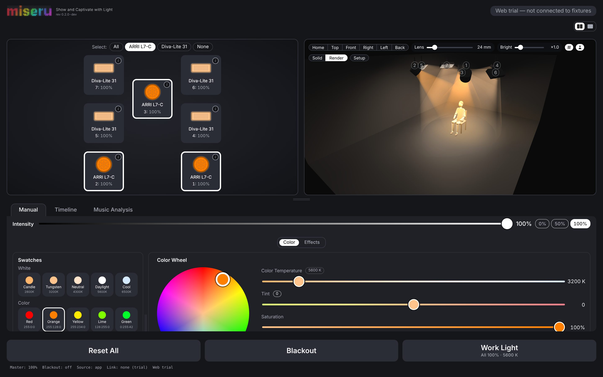
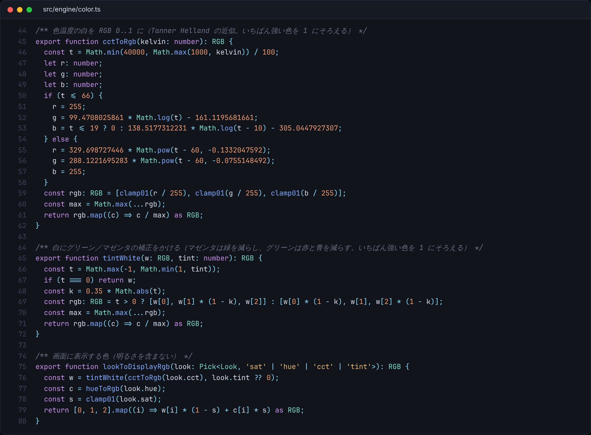

# miseru



**見せる**（見えるようにする）と **魅せる**（見栄えをよくする）。照明の二つの役目を、そのまま画面にした照明制御アプリです。英語では *Show and Captivate with Light*。

小学生でも使える、5〜20 灯向けのオープンソース照明制御アプリ。DMX のチャンネル番号を見せず、「明るさ」「色温度」「色」だけで操作できます。東京都立大学の撮影スタジオ（ARRI L7-C 3 台・Kino Flo Diva-Lite 31 4 台）で使うために作っています。

ブラウザで試せる体験版（照明にはつながりません）: <https://lecture.nakayasu.com/miseru/app/>

## できること

- **Manual**: 天井図のライトを選び、明るさ・色温度・色（カラーホイールと色見本）を決める。エフェクト（Strobe・Chase・Pulse・Flicker・Rainbow・Wave。照明側の効果の ch は使わず miseru の中で作るので、全部の照明でそろう。Strobe は 10 Hz まで）も付けられる。
- **3D ビュー**: スタジオを 3D で見ながら操作できる（WebGL、自前の描画）。Render と Solid（形と置き場所だけ）の表示、視点の切り替え、レンズの画角を選べる。
- **Timeline**: 時間に沿ってキー（その時刻の見た目）を打ち、音楽や映像に合わせて光を変える。ファイルへの保存・読み込み（`.miseru`）もできる。
- **Music Analysis**: 曲を分析し、Claude API に演出を考えてもらって Timeline に入れる。API キーは使う人がブラウザで入れ、そのブラウザにだけ保存する（コードやサーバーには入らない）。録音した音も読み込める。
- **Admin**: パスワードで開く先生用の枠。ライトの ch と機種の変更、操作権の強制解除（Release Current Control）、Show Mode（送り手が止まっても最後の光を保つ）など。
- **操作権**: 箱版では、照明を動かせるのは Take Control を押した 1 台だけ。Release か接続が切れたら全消灯して解除する。
- 大きいボタンは **Reset All**・**Blackout**・**Work Light** の 3 つ。照明そのもののファン・ストロボ・DMX アドレス・モードは画面に出さず、安全な値に固定。



## 動かし方は 4 とおり

| 形 | 作り方 | 照明への出口 |
| --- | --- | --- |
| 箱版（ふだん使う形） | `npm run build:box` → 自作 ODE（ODE-DIY）の中に入れる | 箱へ WebSocket、箱が DMX を出す |
| 常駐アプリ版 | `npm run build && npm start` | PC から Art-Net・sACN |
| デモ版 | `npm run build:demo` → `dist/demo/miseru-demo.html` 1 枚 | なし、または DMX USB Pro（Web Serial） |
| ウェブ体験版 | `npm run build:web` → `dist/web/` | なし（3D・Timeline・Music を試すもの） |

スタジオは地下でネットが入らないので、ふだんは箱（自作 ODE）から画面を配ります。インターネットは使いません（Music Analysis の Claude API だけはネットが要ります）。

## 常駐アプリ版

```
iPad / PC のブラウザ ──Wi-Fi──▶ 常駐アプリ（この PC）──有線──▶ Art-Net ノード ──DMX──▶ ライト
                                  ▲
        Max・TouchDesigner などの Art-Net（先生が 1 つだけ選んで流す）
```

- **常駐アプリ**（`src/server`）: 照明の状態を持ち、Art-Net・sACN を送り、画面を配る。
- **画面**（`src/ui`）: React。iPad の横向きを基準に、スマホでも使える。
- **エンジン**（`src/engine`）: ライト定義、色の計算、エフェクト、タイムライン、全消灯・リセット。画面にもサーバーにも依存しないのでテストしやすい。

```sh
npm install
npm run build
cp miseru.config.example.json miseru.config.json   # 送信先などを書き換える
npm start
```

起動すると、ターミナルに **接続コード**（6 けた）が出ます。iPad などで `http://<この PC の IP>:8080/` を開き、コードを入れるとその端末が登録されます。コードは常駐アプリを動かしている PC の `http://localhost:8080/api/pair-code` でも確認できます。

ライトを持っていなくても、`artnet.host` を空にすれば画面の中だけで試せます。開発中は `npm run dev`（画面は http://localhost:5173/ 、変更が自動で反映されます）。テストは `npm test`、型の確認は `npm run typecheck`。

## 箱版（自作 ODE に送る）

PC を置かずに使う形です。画面とエンジンはブラウザの中で動き、できた 512 スロットの DMX を、箱へ WebSocket で送ります（取り決めは `src/box/protocol.ts`、ロックの規則は `src/box/core.ts`）。

```sh
npm run build:box   # dist/box に画面を作る（箱の中に入れるのはこれ。gzip で約 56kB）
npm run box:sim -- --port 8081 --pin 0000 --dir dist/box --artnet-in
```

`box:sim` が **偽の箱**です。`--name`（箱の名前、既定 ODE-DIY）、`--allow 192.0.2.10,192.0.2.11`（許可リスト）、`--sacn-in`（sACN を受ける、ユニバースは `--sacn-universe`、既定 1）も付けられます。本物と同じ仕様で、画面を配り、WebSocket と Art-Net を受け、ロックの規則（`src/box/core.ts`）に従って DMX を出します。いま出している値は `http://localhost:8081/api/dmx` で見られます。ファームの受け入れ試験の相手にも使えます。

- 箱から配られた画面は、`ws://<配られたホスト>/ws` につなぎ、`hello` → `claim` のあと、変化中は約 30fps、変化がなくても 1 秒に 1 回、フレームを送ります。
- 画面の Release は `release`（待たずに全消灯して解除）。Admin から PIN で `force_release` と Show Mode（公演モード）の入り切りができます。
- ロックを持っている間は、iPad の画面が消えないようにします（Wake Lock）。
- 開発中は、別のホストの箱を `?box=192.0.2.230` で指定できます。

## 設定（miseru.config.json）

| 項目 | 意味 |
| --- | --- |
| `patch` | 使うパッチ。`tmu-photo-studio`（都立大 撮影スタジオ、天井の 7 台・68ch）か、床置きの白 4 灯を足した `tmu-photo-studio-floor` |
| `artnet.host` | Art-Net の送信先（ODE の IP）。空なら送らない |
| `artnet.universe` | Art-Net のユニバース番号（0 始まり） |
| `sacn.enabled` | true にすると sACN（E1.31）も送る。Art-Net と同じ内容 |
| `sacn.universe` | sACN のユニバース番号（1 始まり。省略すると Art-Net の番号 + 1） |
| `sacn.host` | 空ならマルチキャスト、入れればその IP へ直接送る |
| `sacn.priority` | 優先度 0〜200（省略すると 100） |
| `artnet.bindAddress` | 送信に使うこちらの IP。ODE だけをつないだ LAN の口を指定する |
| `input.enabled` / `input.bindAddress` | Wi-Fi 側から届く Art-Net を受け取り、先生用画面で出どころを切り替える |
| `teacherPin` | 先生用画面の PIN。空なら先生用の操作は使えない |
| `requirePairing` | `false` で接続コードなしで操作できる（開発用） |

## 安全のための決まり

- 操作できるのは接続コードで登録した端末だけ。コードを 5 回まちがえると 1 分止まる。
- 出どころの切り替えは先生用 PIN が必要。
- 照明そのもののファン、プリセット、ストロボ、DMX アドレス、モードは画面に出さず、安全な値に固定。
- DMX のライトはアプリを閉じても最後の状態のまま。使い終わったら Reset All か Blackout → 消えたのを目で確認 → ブレーカー、の順に。

## ライト定義

`src/engine/fixtures.ts`。ひな形（明るさだけ、RGB、RGBW、明るさ + RGB / RGBW）と、スタジオの 2 機種。

| ライト | モード | 状態 |
| --- | --- | --- |
| ARRI L7-C Plus | Mode 1: CCT & RGBW 8 bit（12ch） | スタジオ資料で確認済み。CCT 値と色温度の対応は両端だけ分かっているので直線で仮置き |
| Kino Flo Diva-Lite 31 | P25: xfade CCT & RGB 8 bit（8ch） | **チャンネル表が未確認**。ARRI と同じ並びで仮置き。実機かメーカー資料で確かめる |

## DMX USB Pro を直接つなぐ

デモ版（`npm run build:demo`）を Chrome か Edge で開くと、上に Connect DMX USB Pro のボタンが出ます（Web Serial を使います）。押してポートを選ぶと、画面の操作がそのまま DMX に出ます。常駐アプリも箱もいらない、いちばん小さい構成です。

## ライセンス

MIT（[LICENSE](LICENSE)）
